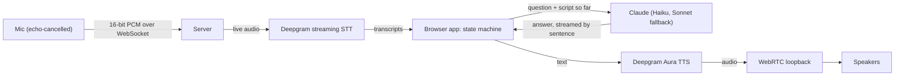

# InteraCast

**A podcast you can talk back to.** InteraCast reads an episode aloud, and you can cut in at any moment, just like interrupting a friend. Ask "wait, how many passengers?" and the host stops mid-sentence, answers in a second or two, then picks the story back up exactly where you left it.

<!-- Demo video: add a link or GIF here -->

## What it does

- **Barge-in, anytime:** start talking and the narrator stops, answers briefly using the episode script (and general knowledge for related questions), then resumes from the interrupted sentence.
- **Works over speakers:** the narrator's audio is routed through a local WebRTC loopback so Chrome's echo canceller removes it from the mic, the same way video calls do. The narrator also ducks its volume the moment you start speaking.
- **Natural conversation control:** "wait a minute" holds and checks in; "pause" waits indefinitely while you keep chatting; "ok, proceed" resumes. Reactions like "that's cool" don't interrupt, and TV or video audio in the background is ignored.
- **Navigate by voice:** "go back to the part about the mayor", "skip ahead", "jump to 0:40", or click any line.
- **Spoiler-aware previews:** "what's coming up?" gets a one-line tease and an offer to skip there; insist and you get the gist.
- **Fast:** answers stream from Claude a sentence at a time and are spoken as they arrive, with fixed phrases pre-rendered so commands respond instantly.

## How it works



- **Browser (`public/`):** a state machine (narrating, listening, answering, paused, …) decides what each utterance means: a barge-in, a command, a follow-up, a reaction or background noise. `engines.js` handles audio in and out, and `pcm-worklet.js` turns the mic into PCM chunks.
- **Server (`server.js`):** a small Node server that keeps API keys off the browser, relays the mic to Deepgram, caches narrator audio on disk, and calls Claude. Claude tags each reply (episode, related, off-topic, preview, resume, pause, background…) so the app knows what to do next.
- **The episode (`public/episode.js`):** a script split into sentences, and each sentence is a resume checkpoint. Swap in your own.

The original interaction design is in [docs/flowchart.jpg](docs/flowchart.jpg), and a manual test checklist is in [docs/test-checklist.md](docs/test-checklist.md).

**Tech:** Node.js, WebRTC, Web Audio (AudioWorklet), WebSockets, Deepgram (nova-3 STT, Aura-2 TTS), Anthropic Claude API.

## Run it

Needs Node 18+ and **Google Chrome** (or Edge).

```bash
npm install
cp .env.example .env    # then open .env and paste your keys after the = signs
npm start
```

`ANTHROPIC_API_KEY` lets Claude write the narrator's answers; `DEEPGRAM_API_KEY` gives the narrator its voice and hears you. Keys exported in the terminal override the file.

Open http://localhost:3000, press **Play**, and allow the microphone. Then just start talking whenever you want to cut in.

Get a Deepgram key at https://console.deepgram.com (new accounts come with free credits). Change the voice with `DEEPGRAM_VOICE` (default `aura-2-thalia-en`).

### Speakers or headphones

With `DEEPGRAM_API_KEY` set, speakers and a camera or desk mic are fine. The narrator plays through the page over a local WebRTC loopback, so Chrome's echo canceller knows what the speakers are playing and removes it from your mic, the same way video calls do. The narrator also drops to a quarter volume the moment the mic hears you, before your words are even recognized. If the narrator still cuts itself off in your room, raise `DUCK_LEVEL` in `public/app.js` a little.

Without a Deepgram key it falls back to the browser's built-in voice and speech recognition. That mode can't cancel echo, so wear headphones. In Chromium or Firefox it can't hear you at all; use the Interrupt button or Space bar and type.

### Without keys

Without `ANTHROPIC_API_KEY` the narrator just repeats the sentence that best matches your question.

## Known limits

- Resume is at sentence level: the interrupted sentence is re-read from its start, not mid-word.
- In the browser fallback, voice quality depends on the voices your OS and browser provide.
- Echo cancellation depends on the room and the mic: it holds up well with desktop speakers and a webcam mic, and phones haven't been tested yet.
- In the browser fallback, Chrome's speech recognition sends audio to Google.
